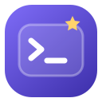

<p align="center">
  
</p>

<h1 align="center">Misja: Informatyka</h1>

<p align="center">
  Interaktywna aplikacja przeglądarkowa z krótkimi zadaniami z informatyki dla uczniów klas 3–8.
</p>

<p align="center">
  <a href="https://lepczynski-cloud.github.io/misja-informatyka/"><strong>Uruchom aplikację online</strong></a>
  ·
  <a href="GITHUB-SETUP.md">Instrukcja publikacji</a>
  ·
  <a href="docs/ADDING-TASKS.md">Dodawanie zadań</a>
</p>

<p align="center">
  <a href="https://github.com/lepczynski-cloud/misja-informatyka/actions/workflows/pages.yml"></a>
  
  
  <a href="LICENSE"></a>
  <a href="CONTENT-LICENSE.md"></a>
</p>

> [!IMPORTANT]
> **Projekt jest w fazie budowy.** Aplikacja jest gotowa do testów i codziennych ćwiczeń, ale katalog zadań oraz mechaniki będą nadal rozwijane. To uzupełnienie lekcji, a nie oficjalny podręcznik, system egzaminacyjny ani zamiennik Scratcha, arkusza kalkulacyjnego lub pracy nauczyciela.


## Po co powstał ten projekt

Misja: Informatyka ma ułatwiać krótkie, przyjemne powtórki bez zakładania konta i instalowania programu. Uczeń może sam wybrać klasę, temat oraz trudność. Nauczyciel może przefiltrować katalog, zaznaczyć konkretne zadania i wysłać gotowy link całej klasie.

Zakres treści został przygotowany na podstawie obszarów obecnych w polskiej edukacji informatycznej, takich jak rozwiązywanie problemów, algorytmy, praca z danymi i dokumentami, sieci, krytyczna ocena informacji, bezpieczeństwo, etyka oraz licencje. Projekt nie realizuje całej podstawy programowej i nie zastępuje praktycznej pracy w innych narzędziach.

## Najważniejsze funkcje

### Dla ucznia

- samodzielny wybór klasy od 3 do 8,
- wybór jednego z 9 obszarów tematycznych,
- filtrowanie poziomu trudności,
- losowanie zestawu 5, 10, 15 lub 20 zadań,
- przeglądanie pełnego katalogu i uruchamianie pojedynczych misji,
- podpowiedź po pierwszej nieudanej próbie,
- wyjaśnienie odpowiedzi po zakończeniu zadania,
- gwiazdki, odznaki, fanfary i konfetti,
- powtórka całego zestawu lub tylko trudnych zadań,
- podsumowanie do pokazania nauczycielowi,
- dyplom do wydrukowania.

### Dla nauczyciela

- filtrowanie według klasy, tematu, trudności i rodzaju zadania,
- wyszukiwanie po tytule oraz treści,
- ręczny wybór zadań,
- losowanie zestawu z aktywnych filtrów,
- gotowe propozycje zestawów,
- zmiana kolejności i nazwy zestawu,
- utworzenie linku dla uczniów,
- użycie systemowego okna udostępniania na telefonie,
- pobranie konfiguracji zestawu w formacie JSON,
- maksymalnie 30 zadań w jednym udostępnionym zestawie.


## Katalog zadań

Pierwsza wersja zawiera **162 zadania**, po **27 dla każdej klasy**.

| Obszar | Liczba zadań | Przykładowe zagadnienia |
|---|---:|---|
| Komputer i pliki | 18 | urządzenia, foldery, formaty, kopie zapasowe, reprezentacja danych |
| Internet i wyszukiwanie | 18 | przeglądarka, skuteczne zapytania, adresy stron, źródła informacji |
| Cyberbezpieczeństwo | 18 | hasła, phishing, aktualizacje, prywatność, reagowanie na zagrożenia |
| Logika i algorytmy | 18 | kolejność kroków, warunki, pętle, zmienne, znajdowanie błędów |
| Dane i arkusz | 18 | tabele, formuły, wykresy, sortowanie, filtrowanie i interpretacja |
| Tworzenie cyfrowe | 18 | dokumenty, prezentacje, grafika, multimedia i podstawy WWW |
| AI z głową | 18 | formułowanie poleceń, weryfikacja, prywatność, błędy i odpowiedzialność |
| Sieci i WWW | 18 | Wi-Fi, router, DNS, adres IP, protokoły i droga danych |
| Prawo i kultura cyfrowa | 18 | prawa autorskie, licencje, netykieta, współpraca i ślad cyfrowy |

Dostępnych jest sześć rodzajów interakcji:

1. jedna poprawna odpowiedź,
2. kilka poprawnych odpowiedzi,
3. układanie kroków we właściwej kolejności,
4. łączenie elementów w pary,
5. przyporządkowywanie do kategorii,
6. wpisywanie krótkiej odpowiedzi.

Każde zadanie ma krótką sytuację, polecenie, podpowiedź oraz wyjaśnienie. Walidator sprawdza strukturę katalogu podczas każdego pull requestu i przed publikacją strony.

## Prywatność i działanie bez kont

Aplikacja nie ma backendu i nie wymaga logowania. Nie przechowuje imion, odpowiedzi ani wyników uczniów na serwerze. Nie zawiera reklam, analityki ani zewnętrznych skryptów śledzących.

- Link od nauczyciela zawiera tylko nazwę zestawu i identyfikatory zadań.
- Wynik istnieje wyłącznie w aktualnej sesji przeglądarki.
- Jedynym ustawieniem zapisywanym lokalnie jest wybrany motyw.
- Po pierwszym uruchomieniu online aplikacja może działać offline dzięki service workerowi.

Brak centralnego zapisu wyników jest świadomym założeniem pierwszej wersji. Dzięki temu projekt pozostaje prosty, bezpieczny i możliwy do hostowania bezpłatnie na GitHub Pages.

## Motyw i dostępność

Domyślnie aplikacja korzysta z motywu systemowego. Użytkownik może ręcznie wybrać motyw jasny albo ciemny. Interfejs jest responsywny i działa na telefonach, tabletach oraz komputerach.


Projekt uwzględnia między innymi:

- obsługę klawiatury,
- widoczne stany fokusu,
- semantyczne nagłówki i etykiety pól,
- komunikaty dla czytników ekranu,
- ograniczenie animacji zgodnie z ustawieniem systemowym,
- czytelny kontrast w jasnym i ciemnym motywie.

## Uruchomienie lokalne

Wymagany jest Node.js 20 lub nowszy.

```bash
git clone https://github.com/lepczynski-cloud/misja-informatyka.git
cd misja-informatyka
npm ci
npm run dev
```

Aplikacja będzie dostępna pod adresem:

```text
http://127.0.0.1:4173
```

Nie należy otwierać `index.html` bezpośrednio przez `file://`, ponieważ przeglądarka może wtedy zablokować wczytanie katalogu JSON.

### Dostępne polecenia

```bash
npm run dev       # lokalny serwer dla katalogu public
npm run validate  # kontrola katalogu zadań i składni JavaScript
npm run build     # budowanie gotowej strony do katalogu dist
npm run preview   # budowanie i podgląd katalogu dist
npm test          # pełna walidacja i budowanie
```

## Publikacja na GitHub Pages

Repozytorium zawiera gotowy workflow:

```text
.github/workflows/pages.yml
```

Po każdym pushu do gałęzi `main` GitHub Actions:

1. pobiera repozytorium,
2. instaluje środowisko Node.js,
3. sprawdza wszystkie zadania i składnię aplikacji,
4. buduje katalog `dist`,
5. publikuje wynik na GitHub Pages.

Pełna instrukcja znajduje się w pliku [GITHUB-SETUP.md](GITHUB-SETUP.md).

Docelowy adres dla proponowanej nazwy repozytorium:

```text
https://lepczynski-cloud.github.io/misja-informatyka/
```

## Dodawanie nowych zadań

Treści są przechowywane w jednym pliku:

```text
public/data/tasks.json
```

Każdy typ zadania ma jawny i prosty schemat JSON. Szczegółowe przykłady oraz zasady redakcyjne znajdują się w dokumentach:

- [Dodawanie zadań](docs/ADDING-TASKS.md)
- [Zasady tworzenia treści](docs/CONTENT-GUIDE.md)
- [Architektura projektu](docs/ARCHITECTURE.md)
- [Współpraca przy projekcie](CONTRIBUTING.md)

Po zmianie katalogu należy uruchomić:

```bash
npm run validate
```

## Struktura repozytorium

```text
misja-informatyka/
├── .github/
│   ├── ISSUE_TEMPLATE/
│   └── workflows/
├── docs/
│   └── screenshots/
├── public/
│   ├── assets/
│   ├── data/tasks.json
│   ├── app.js
│   ├── index.html
│   ├── manifest.webmanifest
│   ├── service-worker.js
│   └── styles.css
├── scripts/
│   ├── build.mjs
│   ├── serve.mjs
│   └── validate-tasks.mjs
├── CONTRIBUTING.md
├── GITHUB-SETUP.md
├── package.json
└── README.md
```

Katalog `dist` jest generowany automatycznie i nie trzeba go ręcznie edytować.

## Plan rozwoju

- kolejne zadania i bardziej rozbudowane scenariusze,
- dodatkowe mechaniki interakcji,
- lepszy podgląd zestawu przed wysłaniem,
- opcjonalny kod QR tworzony lokalnie w przeglądarce,
- możliwość importowania własnego zestawu przez ucznia,
- dalsze testy dostępności i użyteczności,
- oznaczenie wersji stabilnej po zebraniu opinii nauczycieli i uczniów.

Pomysły i błędy można zgłaszać przez [GitHub Issues](https://github.com/lepczynski-cloud/misja-informatyka/issues).

## Źródła zakresu edukacyjnego

Zakres tematów został zainspirowany publicznie dostępnymi wymaganiami edukacji informatycznej. Przy rozwijaniu treści warto regularnie sprawdzać aktualne dokumenty:

- [Podstawa programowa informatyki dla szkoły podstawowej, klasy IV–VIII](https://zpe.gov.pl/podstawa-programowa/szkola-podstawowa/informatyka)
- [Podstawa programowa edukacji wczesnoszkolnej](https://zpe.gov.pl/podstawa-programowa/szkola-podstawowa/edukacja-wczesnoszkolna)

Treści w aplikacji są autorskimi ćwiczeniami inspirowanymi zakresem szkolnym. Nie są materiałem zatwierdzonym przez Ministerstwo Edukacji Narodowej.

## Licencje

- Kod aplikacji: [MIT](LICENSE)
- Treści edukacyjne w `public/data/tasks.json`: [CC BY 4.0](CONTENT-LICENSE.md)

Autor: Wojciech Lepczyński
