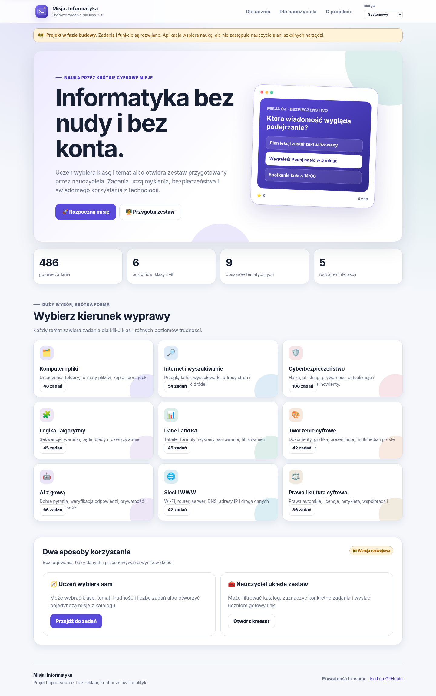
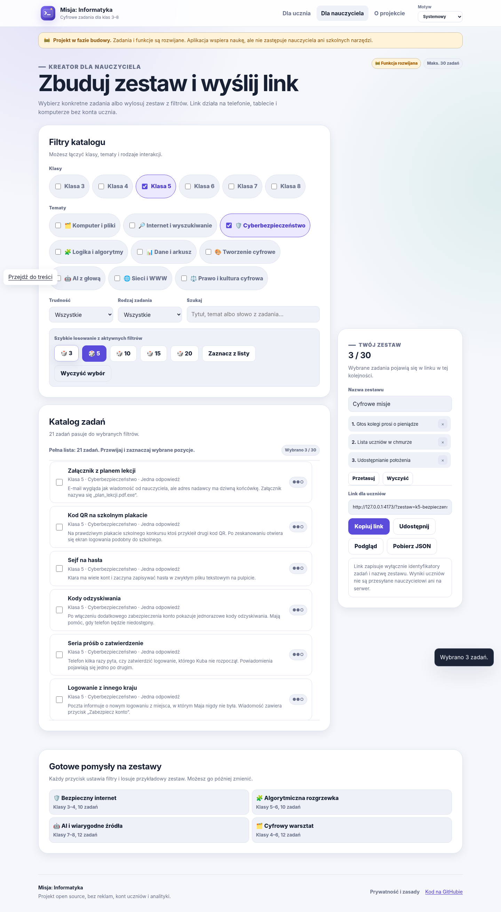

<p align="center">
  
</p>

<h1 align="center">Misja: Informatyka</h1>

<p align="center">
  Interaktywna aplikacja przeglądarkowa z krótkimi zadaniami z informatyki dla uczniów klas 3-8.
</p>

<p align="center">
  <a href="https://lepczynski-cloud.github.io/misja-informatyka/"><strong>Uruchom aplikację online</strong></a>
  ·
  <a href="GITHUB-SETUP.md">Konfiguracja repozytorium</a>
  ·
  <a href="docs/ADDING-TASKS.md">Dodawanie zadań</a>
</p>

<p align="center">
  <a href="https://github.com/lepczynski-cloud/misja-informatyka/actions/workflows/ci.yml"></a>
  
  
  
  <a href="LICENSE"></a>
  <a href="CONTENT-LICENSE.md"></a>
</p>

> [!IMPORTANT]
> **Projekt jest w fazie budowy.** Aplikacja jest gotowa do testów i ćwiczeń, ale treści, mechaniki oraz interfejs będą nadal rozwijane. To uzupełnienie lekcji, a nie oficjalny podręcznik, system egzaminacyjny ani zamiennik Scratcha, arkusza kalkulacyjnego lub pracy nauczyciela.



## Po co powstał ten projekt

Misja: Informatyka ma ułatwiać krótkie, przyjemne powtórki bez instalowania programu i zakładania konta. Uczeń może sam wybrać klasę, temat, trudność oraz długość zestawu. Nauczyciel może przefiltrować cały katalog, przejrzeć opisy zadań, zaznaczyć konkretne pozycje i wysłać gotowy link klasie.

Zakres treści obejmuje wybrane obszary obecne w edukacji informatycznej: pracę z plikami, wyszukiwanie informacji, bezpieczeństwo, logiczne rozwiązywanie problemów, dane, tworzenie materiałów cyfrowych, sieci, prawa autorskie oraz rozsądne korzystanie z narzędzi AI. Projekt nie próbuje realizować całej podstawy programowej i nie zastępuje praktycznej pracy w innych narzędziach.

## Najważniejsze funkcje

### Dla ucznia

- samodzielny wybór klasy od 3 do 8,
- wybór jednego z 9 obszarów tematycznych,
- filtrowanie poziomu trudności,
- losowanie zestawu 3, 5, 10, 15 lub 20 zadań,
- przeglądanie katalogu i uruchamianie pojedynczych misji,
- podpowiedź po pierwszej nieudanej próbie,
- wyjaśnienie odpowiedzi po zakończeniu zadania,
- gwiazdki, odznaki, fanfary i konfetti,
- powtórka całego zestawu lub tylko zadań, które sprawiły trudność,
- podsumowanie do pokazania nauczycielowi,
- dyplom do wydrukowania.

### Dla nauczyciela

- filtrowanie według klasy, tematu, trudności i rodzaju zadania,
- wyszukiwanie po tytule, sytuacji, pytaniu i odpowiedziach,
- pełna przewijana lista wszystkich zadań pasujących do filtrów,
- podgląd krótkiego opisu przed zaznaczeniem zadania,
- ręczny wybór konkretnych zadań,
- szybkie losowanie 3, 5, 10, 15 lub 20 zadań,
- gotowe propozycje zestawów,
- nazwanie i przetasowanie zestawu,
- utworzenie linku działającego na innym urządzeniu,
- użycie systemowego okna udostępniania na telefonie,
- pobranie konfiguracji zestawu w formacie JSON,
- maksymalnie 30 zadań w jednym udostępnionym zestawie.



## Katalog zadań

Wersja 0.2.0 zawiera **486 zadań**. Największy wybór przygotowano dla klas 5 i 6.

| Klasa | Liczba zadań |
|---|---:|
| 3 | 65 |
| 4 | 75 |
| 5 | 105 |
| 6 | 105 |
| 7 | 75 |
| 8 | 61 |

| Obszar | Liczba zadań | Przykładowe zagadnienia |
|---|---:|---|
| Komputer i pliki | 48 | urządzenia, foldery, formaty, kopie zapasowe, porządek cyfrowy |
| Internet i wyszukiwanie | 54 | skuteczne zapytania, adresy stron, źródła i wiarygodność informacji |
| Cyberbezpieczeństwo | 108 | hasła, phishing, oszustwa, prywatność, aktualizacje i reakcje na zagrożenia |
| Logika i algorytmy | 45 | warunki, pętle, zmienne, analiza instrukcji i znajdowanie błędów |
| Dane i arkusz | 45 | tabele, formuły, wykresy, sortowanie, filtrowanie i interpretacja |
| Tworzenie cyfrowe | 42 | dokumenty, prezentacje, grafika, multimedia i podstawy WWW |
| AI z głową | 66 | precyzyjne pytania, poprawianie poleceń, wyszukiwanie, weryfikacja i prywatność |
| Sieci i WWW | 42 | Wi-Fi, router, DNS, adres IP, serwer i droga danych |
| Prawo i kultura cyfrowa | 36 | prawa autorskie, licencje, netykieta, współpraca i ślad cyfrowy |

Aplikacja wykorzystuje pięć rodzajów interakcji:

1. jedna poprawna odpowiedź,
2. kilka poprawnych odpowiedzi,
3. łączenie elementów w pary,
4. przyporządkowywanie do kategorii,
5. wpisywanie krótkiej odpowiedzi.

Dominują zadania jednokrotnego wyboru, obecnie jest ich **436**. Zrezygnowano z układania kroków, ponieważ w wielu codziennych sytuacjach więcej niż jedna kolejność może być poprawna. Pytania dotyczące procesów zostały przepisane tak, aby wymagały jednoznacznego wyboru.

Każde zadanie ma sytuację, jasne polecenie, podpowiedź oraz wyjaśnienie. W kategorii AI nacisk położono na praktyczne przykłady: jak lepiej opisać cel, jak doprecyzować pytanie, jak zawęzić wyszukiwanie, jak poprosić o inną formę wyjaśnienia i jak sprawdzić wynik.

## Prywatność i działanie bez kont

Aplikacja nie ma backendu i nie wymaga logowania. Nie przechowuje imion, odpowiedzi ani wyników uczniów na serwerze. Nie zawiera reklam, analityki ani zewnętrznych skryptów śledzących.

- Link od nauczyciela zawiera tylko nazwę zestawu i identyfikatory zadań.
- Wynik istnieje wyłącznie w aktualnej sesji przeglądarki.
- Jedynym ustawieniem zapisywanym lokalnie jest wybrany motyw.
- Po pierwszym uruchomieniu online aplikacja może działać offline dzięki service workerowi.

Brak centralnego zapisu wyników jest świadomym założeniem. Dzięki temu aplikacja pozostaje prosta, nie wymaga kont dzieci ani utrzymywania bazy danych.

## Motyw i dostępność

Domyślnie aplikacja korzysta z motywu systemowego. Użytkownik może ręcznie wybrać motyw jasny albo ciemny. Interfejs jest responsywny i działa na telefonach, tabletach oraz komputerach.


Projekt uwzględnia między innymi:

- obsługę klawiatury,
- widoczne stany fokusu,
- semantyczne nagłówki i etykiety pól,
- komunikaty dla czytników ekranu,
- ograniczenie animacji zgodnie z ustawieniem systemowym,
- czytelny kontrast w jasnym i ciemnym motywie.

## Uruchomienie lokalne

Wymagany jest Node.js 20 lub nowszy.

```bash
git clone https://github.com/lepczynski-cloud/misja-informatyka.git
cd misja-informatyka
npm ci
npm run dev
```

Aplikacja będzie dostępna pod adresem:

```text
http://127.0.0.1:4173
```

Nie należy otwierać `index.html` bezpośrednio przez `file://`, ponieważ przeglądarka może zablokować wczytanie katalogu JSON.

### Dostępne polecenia

```bash
npm run dev       # lokalny serwer dla katalogu public
npm run validate  # kontrola katalogu zadań i składni JavaScript
npm run build     # budowanie gotowej strony do katalogu dist
npm run preview   # budowanie i podgląd katalogu dist
npm test          # pełna walidacja i budowanie
```

## Dodawanie nowych zadań

Treści są przechowywane w jednym pliku:

```text
public/data/tasks.json
```

Szczegółowe przykłady oraz zasady redakcyjne znajdują się w dokumentach:

- [Dodawanie zadań](docs/ADDING-TASKS.md)
- [Zasady tworzenia treści](docs/CONTENT-GUIDE.md)
- [Architektura projektu](docs/ARCHITECTURE.md)
- [Współpraca przy projekcie](CONTRIBUTING.md)

Po zmianie katalogu należy uruchomić:

```bash
npm run validate
```

Walidator sprawdza między innymi strukturę zadań, poprawność odpowiedzi, unikalność identyfikatorów, minimalną liczbę treści, przewagę pytań jednokrotnego wyboru oraz założone proporcje katalogu.

## Struktura repozytorium

```text
misja-informatyka/
├── .github/
│   ├── ISSUE_TEMPLATE/
│   └── workflows/
├── docs/
│   └── screenshots/
├── public/
│   ├── assets/
│   ├── data/tasks.json
│   ├── app.js
│   ├── index.html
│   ├── manifest.webmanifest
│   ├── service-worker.js
│   └── styles.css
├── scripts/
│   ├── build.mjs
│   ├── serve.mjs
│   └── validate-tasks.mjs
├── CONTRIBUTING.md
├── GITHUB-SETUP.md
├── package.json
└── README.md
```

Katalog `dist` jest generowany automatycznie i nie trzeba go ręcznie edytować.

## Plan rozwoju

- przegląd i dopracowywanie treści z nauczycielami oraz uczniami,
- kolejne praktyczne scenariusze,
- lepszy podgląd zestawu przed wysłaniem,
- opcjonalny kod QR tworzony lokalnie w przeglądarce,
- możliwość importowania własnego zestawu przez ucznia,
- dalsze testy dostępności i użyteczności,
- oznaczenie wersji stabilnej po zebraniu opinii.

Pomysły i błędy można zgłaszać przez [GitHub Issues](https://github.com/lepczynski-cloud/misja-informatyka/issues).

## Źródła zakresu edukacyjnego

Zakres tematów został zainspirowany publicznie dostępnymi wymaganiami edukacji informatycznej. Przy rozwijaniu treści warto regularnie sprawdzać aktualne dokumenty:

- [Podstawa programowa informatyki dla szkoły podstawowej, klasy IV-VIII](https://zpe.gov.pl/podstawa-programowa/szkola-podstawowa/informatyka)
- [Podstawa programowa edukacji wczesnoszkolnej](https://zpe.gov.pl/podstawa-programowa/szkola-podstawowa/edukacja-wczesnoszkolna)

Treści w aplikacji są autorskimi ćwiczeniami inspirowanymi zakresem szkolnym. Nie są materiałem zatwierdzonym przez Ministerstwo Edukacji Narodowej.

## Licencje

- Kod aplikacji: [MIT](LICENSE)
- Treści edukacyjne w `public/data/tasks.json`: [CC BY 4.0](CONTENT-LICENSE.md)

Autor: Wojciech Lepczyński
